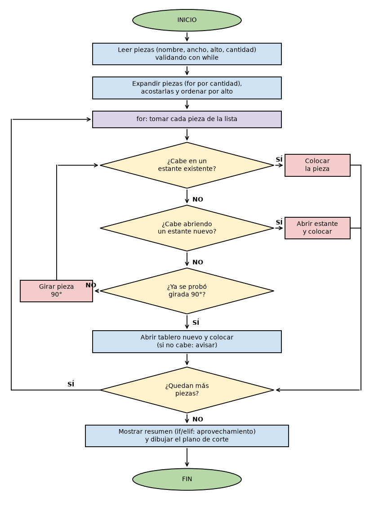
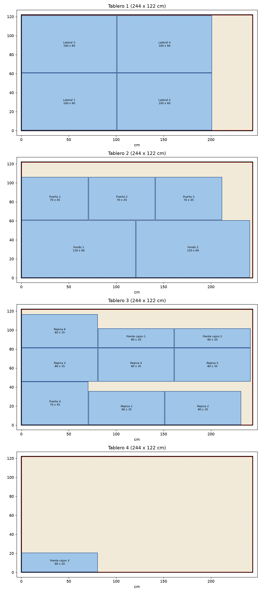

# Optimizador de cortes de tablero

**Estudiante:** Miguel Angel Guerrero J.
**Programa:** Especialización en Diseño y Creación con IA — Lenguajes de Programación Multiforma
**Universidad:** Jorge Tadeo Lozano
**Actividad:** Identificación y análisis de estructuras de decisión

Programa en Python que organiza piezas de mobiliario sobre tableros estándar para
usar la menor cantidad posible de tableros, informa el aprovechamiento de cada uno
y dibuja el plano de corte.

> Desarrollado con apoyo de Claude Code (asistente de programación con IA). Las
> condiciones del problema y las decisiones de diseño fueron definidas por el estudiante.

## 1. Descripción del problema

Al fabricar mobiliario (mesas, puertas, repisas, escritorios, mesas de noche) se corta
cada pieza de tableros de madecord estándar de 2,44 m x 1,22 m. Acomodar las piezas a
ojo genera desperdicio y sobrecostos. Se busca un programa en Python que reciba la lista
de piezas, las acomode para usar el menor número de tableros, informe el aprovechamiento
de cada uno y dibuje el plano de corte.

**Condiciones reales consideradas:**

- La sierra desgasta **5 mm por línea de corte**.
- El tablero se **refila 5 mm en cada borde**, por lo que la zona útil es de **243 x 121 cm**.

**Estructuras exigidas:**

- Condicionales `if / elif / else`: decidir dónde cabe la pieza, validar datos y clasificar el aprovechamiento.
- Ciclos `while`: menú y validación de entradas.
- Ciclos `for`: recorrer piezas, tableros y estantes.

## 2. Archivos

| Archivo | Contenido |
|---|---|
| `cortes_tablero.py` | Código fuente comentado |
| `diagrama_flujo.png` | Diagrama de flujo del algoritmo |
| `plano_de_corte.png` | Ejemplo de plano generado por el programa |
| `README.md` | Esta documentación |

## 3. Cómo ejecutarlo

Requiere Python 3 y la librería `matplotlib`:

```bash
pip install matplotlib
python cortes_tablero.py
```

El programa muestra un menú:

1. Usar la lista de ejemplo (mueble de cocina).
2. Ingresar las propias piezas (nombre, ancho, alto y cantidad en cm; se termina escribiendo `fin`).
3. Salir.

Al calcular, muestra el resumen en consola y guarda el plano en `plano_de_corte.png`.

## 4. Cómo funciona el algoritmo

Se usa el método de **franjas (shelf packing)**:

1. Se expande la lista: una pieza por cada unidad de la cantidad pedida.
2. Se acuestan las piezas (ancho ≥ alto) y se ordenan de mayor a menor alto.
3. Cada tablero se divide en franjas horizontales (estantes).
4. Cada pieza se coloca en el primer estante donde quepa; si no cabe en ninguno, se abre
   un estante nuevo; si el tablero está lleno, se abre un tablero nuevo.
5. Se intenta también la pieza girada 90° antes de abrir otro tablero.
6. Entre piezas contiguas se descuentan 5 mm de sierra y alrededor del tablero 5 mm de refilado.

## 5. Pseudocódigo

```text
ALGORITMO OptimizadorDeCortes
  CONSTANTES  ANCHO = 244, ALTO = 122, SIERRA = 0.5, REFILADO = 0.5   (cm)
              ANCHO_UTIL = ANCHO - 2*REFILADO ; ALTO_UTIL = ALTO - 2*REFILADO

  INICIO
    lista <- vacía
    MIENTRAS el nombre ingresado sea distinto de "fin" HACER
        MIENTRAS ancho no sea válido HACER pedir ancho FIN MIENTRAS
        MIENTRAS alto no sea válido  HACER pedir alto  FIN MIENTRAS
        MIENTRAS cantidad no sea válida HACER pedir cantidad FIN MIENTRAS
        agregar (nombre, ancho, alto, cantidad) a lista
    FIN MIENTRAS

    unidades <- vacía
    PARA CADA (nombre, ancho, alto, cantidad) EN lista HACER
        PARA n <- 1 HASTA cantidad HACER
            agregar una pieza a unidades
    ordenar unidades de mayor a menor alto (cada pieza acostada: ancho >= alto)

    tableros <- [tablero vacío]
    PARA CADA pieza EN unidades HACER
        colocada <- FALSO
        PARA CADA tablero EN tableros HACER
            PARA girada EN (FALSO, VERDADERO) HACER
                SI la pieza cabe en un estante existente ENTONCES
                    colocarla ; colocada <- VERDADERO
                SINO SI cabe abriendo un estante nuevo ENTONCES
                    abrir estante y colocarla ; colocada <- VERDADERO
            SI colocada ENTONCES salir del ciclo de tableros
        SI NO colocada ENTONCES
            crear tablero nuevo y colocar la pieza ahí
            SI tampoco cabe ENTONCES avisar "la pieza no cabe"

    PARA CADA tablero EN tableros HACER
        aprovechamiento <- área de piezas / área del tablero * 100
        SI aprovechamiento >= 85 ENTONCES nivel <- "excelente"
        SINO SI aprovechamiento >= 70 ENTONCES nivel <- "bueno"
        SINO SI aprovechamiento >= 50 ENTONCES nivel <- "regular"
        SINO nivel <- "bajo"
        mostrar tablero, aprovechamiento y nivel
    dibujar el plano de corte
  FIN
```

## 6. Diagrama de flujo



## 7. Ejemplo de ejecución

Lista de ejemplo (4 laterales, 4 puertas, 6 repisas, 2 fondos y 3 frentes de cajón):

```text
RESULTADO DEL PLAN DE CORTE
====================================================
Tablero 1: 4 piezas | aprovechamiento  80.6% -> bueno
Tablero 2: 5 piezas | aprovechamiento  80.1% -> bueno
Tablero 3: 9 piezas | aprovechamiento  77.8% -> bueno
Tablero 4: 1 piezas | aprovechamiento   5.4% -> bajo (conviene usar un retazo)
----------------------------------------------------
Tableros necesarios : 4
Aprovechamiento     : 61.0%
Desperdicio         : 4.65 m2
```



La línea roja punteada del plano marca el borde después del refilado.

## 8. Limitaciones y mejoras

El algoritmo **no garantiza la solución óptima**: con el ejemplo usa 4 tableros y el cuarto
lleva una sola pieza, cuando el mínimo teórico serían 3. Llena franjas horizontales y no
aprovecha huecos laterales. Mejoras posibles: probar varios órdenes y orientaciones y
quedarse con la mejor combinación, o permitir cortes más flexibles.

## 9. Aplicación

Antes de cotizar o mandar a fabricar un proyecto de fabricación de mobiliario permite estimar
cuántos tableros se necesitan y cuánto desperdicio habrá, para calcular costos con mayor precisión.
